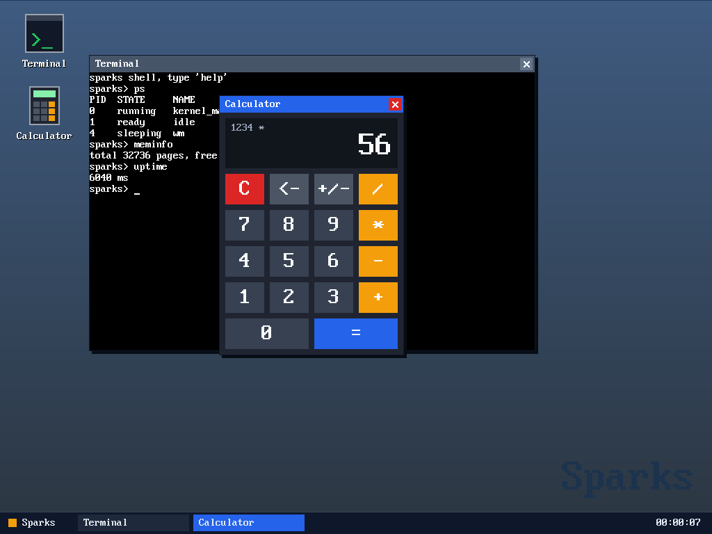

# Sparks

Hobby x86_64 kernel I wrote from scratch, mostly to figure out what actually
happens between GRUB jumping into your code and having a shell with windows on
screen. C plus some AT&T asm, no libc, no code borrowed from other kernels.



It boots, gets into long mode, sets up interrupts, memory and a preemptive
scheduler and then starts a tiny window manager with a terminal (running the
kernel shell) and a calculator. Everything is ring 0 for now, no user mode yet,
so check the limitations at the bottom before expecting too much

## Quick start

    make CC=gcc LD=gcc run

you'll need gcc, binutils, grub2-mkrescue, xorriso, mtools and
qemu-system-x86_64. On Debian/Ubuntu the grub tool is called grub-mkrescue,
just change it in the iso target.

Host gcc works fine, the kernel is built with `-ffreestanding -nostdlib
-mno-red-zone` and no SSE so nothing from the host gets in. If you want a real
x86_64-elf cross compiler there's `toolchain/build.sh`, it builds binutils and
gcc into `toolchain/cross` (takes a while, go get a coffee). After that `source
env.sh` and the Makefile will pick it up by itself.

    make boot-test   # headless, serial log on stdout, quits after 20s
    make debug       # qemu waits for gdb on :1234
    make clean

Boot log goes to COM1, so with `make run` you get it in the terminal and the
desktop in the qemu window.

## Layout

    kernel/boot/boot.S         multiboot2 header, switch to long mode, boot page tables
    kernel/boot/isr.S          exception and irq stubs + their tables
    kernel/boot/task_switch.S  context switch and the first run trampoline
    kernel/src/                everything else, one .c per subsystem
    kernel/include/            one header per .c
    linker.ld                  kernel at 1MiB
    tools/psf2c.py             converts a PSF2 font into font.c
    toolchain/build.sh         optional cross toolchain

To add a module just drop `kernel/src/foo.c` and `kernel/include/foo.h`, the
Makefile globs the sources and -MMD takes care of header deps.

## Boot order

`kernel_main` in kernel.c brings stuff up in this order, and yes the order
matters:

1. serial first so everything after can log
2. IDT, then the TSS (IST1 is the double fault stack)
3. PMM from the multiboot2 memory map. it also reserves the kernel and the
   multiboot info since that gets read again later
4. paging self test, heap at 8GiB, heap self test
5. framebuffer, needs heap and PMM because mapping it allocates page tables
6. PIC, keyboard, mouse, PIT at 100Hz, sti
7. scheduler + two demo tasks that exit by themselves (tests the reaper)
8. window manager if there's a back buffer, plain console otherwise
9. the shell, which runs in the kernel_main task itself

## Virtual memory map

| Address        | What                                                        |
|----------------|-------------------------------------------------------------|
| `0 - 1GiB`     | identity mapped with 2MiB pages in boot.S, kernel at 1MiB   |
| `0x40000000`   | a single 4K page mapped by the boot self test               |
| `0x200000000`  | kernel heap, starts at 1MiB and grows up to 512MiB          |
| `0x400000000`  | framebuffer, write-combining through PAT                    |
| `0x500000000`  | back buffer                                                 |

Physical frames come from a bitmap with a next-fit hint. Page tables get
accessed through the identity map, that's where the 1GiB limitation further
down comes from.

## Scheduling and task switching

The PIT fires at 100Hz and IRQ0 calls `task_yield()`, that's all the preemption
there is. Tasks can be READY, SLEEPING, BLOCKED or DEAD and idle only runs if
nobody else can.

`task_create` doesn't need a special first run path in the scheduler, it just
builds a stack that looks like task_switch left it there: six zeroed callee
saved registers, then `task_trampoline` where the return address would be and
then the entry point. The first switch rets into the trampoline which turns on
interrupts and calls the entry. If the function returns it falls into
`task_exit`, and the stack of the dead task gets freed by whoever yields next
(can't free the stack you're running on).

task_switch never turns interrupts back on, the task being resumed does that
itself with its own `irq_restore`, or with iretq if it got preempted. Every
blocking wait in the kernel looks pretty much like this:

```c
for (;;) {
    uint64_t flags = irq_save();
    if (have_data()) {
        /* take it */
        irq_restore(flags);
        return;
    }
    waiting_pid = task_current_pid();
    task_block();
    irq_restore(flags);
}
```

and whoever produces the data (irq handler or another task) calls
`task_wake(waiting_pid)`. Doing the check and the block inside the same
critical section is what keeps the wakeup from getting lost.

## The desktop

The wm is a task that owns all the window state, so there are no locks
anywhere. Apps create windows (through a small pending queue), draw into their
own surface and set flags for invalidate/focus/close, the wm picks them up
every 15ms or so. Input gets to apps as per window event queues, and if the
task owning a window dies the window goes away with it.

Everything is drawn into a back buffer in RAM and `fb_flush` only copies the
dirty rect out. The mouse pointer only lives on the real framebuffer, so
erasing it is just another copy from the back buffer, no save-under.

## Shell

    help                 list commands
    ps                   task table
    spawn <type> [name]  start a test task: counter, busy (never yields), heap
    kill <pid>           kernel_main, idle and wm are protected
    meminfo / memmap     PMM stats / multiboot2 memory map
    uptime / mouse / echo / clear

arrows, home/end, delete and a 16 entry history all work. `spawn busy` is the
fun one, it spins forever without yielding and the shell stays responsive
anyway.

## Debugging notes

stuff that saved me a lot of time:

- if it reboots in a loop or resets instantly it's almost always a triple
  fault. run
  `qemu-system-x86_64 -cdrom sparks.iso -display none -no-reboot -d int,cpu_reset -D qemu.log`
  and look at the last exceptions before the reset
- exceptions dump vector, error code, rip and rsp on serial and then halt,
  `addr2line -e build/sparks.kernel <rip>` gives you file and line
- `make debug` and then `gdb build/sparks.kernel -ex 'target remote :1234'`
- for testing without a keyboard start qemu with
  `-monitor unix:mon.sock,server,nowait` and drive it with sendkey,
  mouse_move, mouse_button and screendump (I use socat). keep mouse_move
  steps under ~100px, qemu splits bigger jumps into 127 unit packets and the
  leftover piles up on the next moves

## Limitations

This is just where the project is at right now, not bugs I'm about to fix:

- ring 0 only, no user mode, no syscalls, no isolation
- no storage and no filesystem, every program is compiled in
- PIC only, single core
- page tables above 1GiB physical would be unreachable so `-m 2G` can break
  paging_map (qemu default 128MiB is fine)
- the wm recomposes the whole screen on every change
- output from different tasks can get mixed mid line in the terminal
- the linker makes a single RWX segment, that's the ld warning you see

Next steps (user mode, syscalls, VFS + initrd) are in [ROADMAP.md](ROADMAP.md).

## License

MIT, see [LICENSE](LICENSE). The console font in `kernel/src/font.c` is
default8x16 from [kbd](https://github.com/legionus/kbd), converted with
tools/psf2c.py, and it keeps its GPL-2.0-or-later license.
